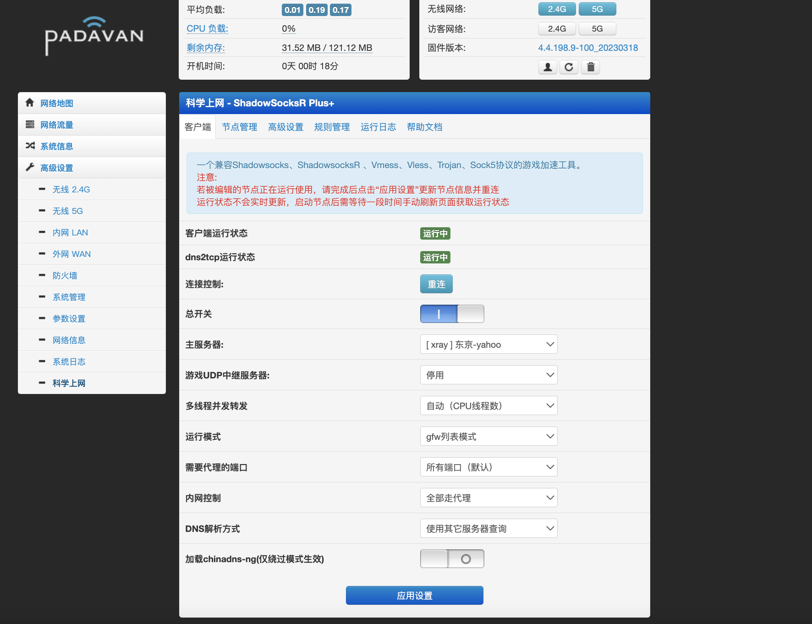
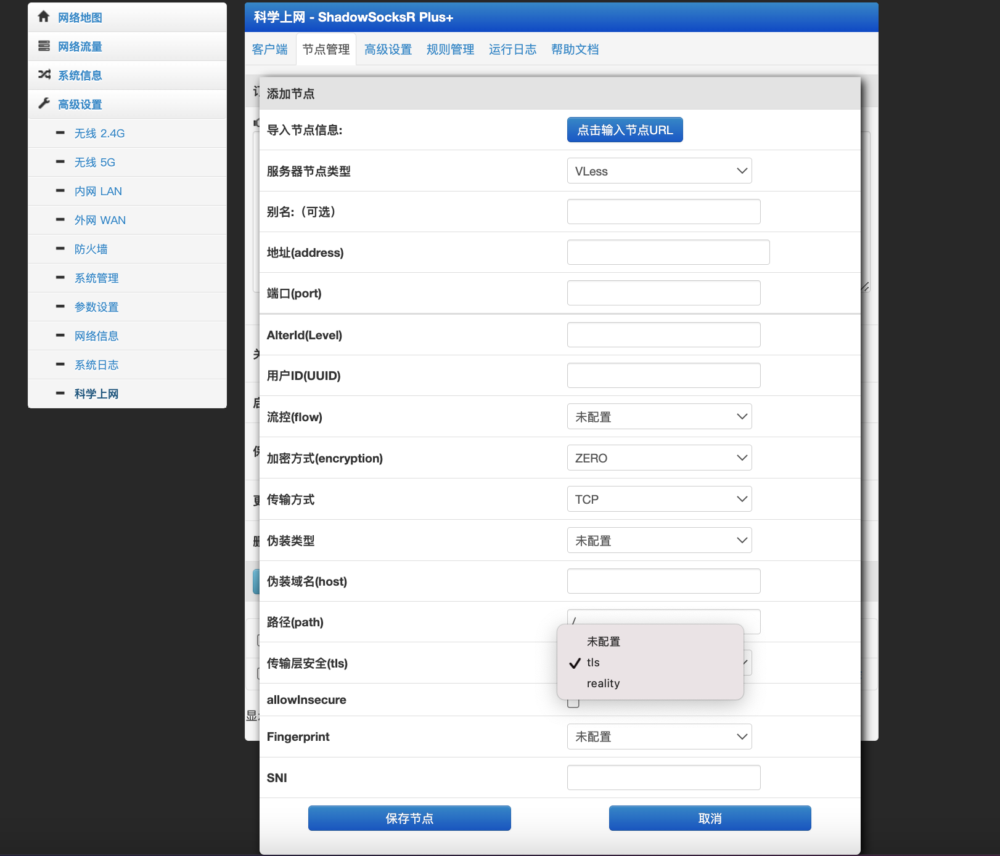

# Padavan RM2100 - Xray 独立插件版

基于 [MeIsReallyBa/padavan-4.4](https://github.com/MeIsReallyBa/padavan-4.4) 源码，为 Redmi AC2100 (RM2100) 定制的固件构建项目。

## 特性

- **Xray 独立插件**：完全重写，不依赖 shadowsocks 插件
- **Xray 版本**：v26.10.31 (MIPSLE)
- **支持协议**：VLESS / VMess / Trojan / Shadowsocks (2022-blake3) / SOCKS5
- **传输层**：TCP / WebSocket / HTTP/2 Upgrade / gRPC / HTTP/2 / xHTTP / mKCP / QUIC
- **安全层**：TLS 1.3 / Reality (shortIds 数组、指纹伪装) / 无加密
- **新特性 (v26.10+)**：TUN 透明代理、xHTTP、增强 gRPC、改进 Mux/XUDP
- **DNS 客户端**：本地/远程/FakeIP 三模式、DoH、按域名分流
- **路由分流**：内置 geoip:cn/geosite:cn/gfw，四种运行模式自动生成
- **节点管理**：Web UI 增删改查、拖拽排序、批量操作
- **节点导入**：支持 `vless://` `vmess://` `trojan://` `ss://` `socks://` `reality://` 标准链接
- **订阅支持**：Base64 订阅链接、关键字过滤、自动去重
- **配置导出**：标准 xray JSON，可直接给 PC 客户端用

## 默认登录

- 地址：http://192.168.2.1
- 用户名：admin
- 密码：admin

## 目录结构

```
.
├── .github/workflows/build-Padavan.yml   # GitHub Actions 构建脚本
├── RM2100.config                         # 固件编译配置
├── xray                                  # Xray v26.10.31 MIPSLE 二进制 (需自行替换)
├── genconfig.lua                         # 配置生成器 (核心)
├── start_xray.sh                         # 启动/停止/重载/防火墙/路由一体化脚本
├── xray_include.sh                       # 公共函数库 (供 rc/firewall/dnsmasq 调用)
├── xray.config                           # NVRAM 默认值模板
├── xray.asp                              # 独立 Web UI
└── README.md
```

## 构建流程

1. Fork 本仓库
2. 替换根目录 `xray` 为 **MIPSLE 版 v26.10.31** 二进制
   - 下载：<https://github.com/XTLS/Xray-core/releases/tag/v26.10.31>
   - 文件：`Xray-linux-mipsle.zip` → 解压 `xray` 覆盖本文件
3. 触发 GitHub Actions：
   - Actions → Build Padavan → Run workflow
   - 或推送任意 commit 触发 `repository_dispatch`
4. 构建产物在 Actions Artifacts / Releases 下载

## 配置说明

### 运行模式 (xray_run_mode)

| 模式 | 行为 |
|------|------|
| `gfw` | 默认直连，geosite:gfw/geoip:gfw 走代理 |
| `router` | 默认代理，geoip:cn/geosite:cn 直连 (推荐) |
| `all` | 全部流量走代理 |
| `oversea` | geoip:cn 走代理，其余直连 (海外回国) |

### DNS 模式 (xray_dns_mode)

| 模式 | 说明 |
|------|------|
| `local` | 仅本地 DNS (默认 223.5.5.5, 114.114.114.114) |
| `remote` | 仅远程 DNS (1.1.1.1, 8.8.8.8 + DoH) |
| `fakeip` | FakeIP 模式，**需开启 TUN** |

### 主要 NVRAM 变量

```bash
xray_enable=1                    # 总开关
xray_run_mode=router             # 运行模式
xray_threads=0                   # 并发线程 (0=自动)
xray_local_port=1080             # 透明代理端口
xray_socks_port=1081             # SOCKS5 端口
xray_http_port=0                 # HTTP 代理端口
xray_tun_enable=0                # TUN 透明代理
xray_proxy_local=0               # 本机流量走代理
xray_global_server=1             # 当前主节点索引
xray_dns_mode=local              # DNS 模式
xray_fakeip_range=198.18.0.0/16  # FakeIP 网段
xray_geo_update=1                # Geo 文件自动更新
xray_log_level=warning           # 日志级别
```

节点存储为 `xray_node_json_1` ~ `xray_node_json_N` (JSON 格式)，`xray_node_max` 记录总数。

## 与 shadowsocks 插件的区别

| 项目 | 旧版 (shadowsocks 插件内置) | 新版 (独立 xray 插件) |
|------|---------------------------|---------------------|
| 协议支持 | 混在一起，字段妥协 | 纯 xray 原生字段，完整支持 |
| 配置生成 | genxrayconfig.lua (简化版) | genconfig.lua (标准 xray JSON) |
| Web UI | 1 个巨大页面管所有协议 | 精简页面，只管 xray |
| Reality 支持 | 基础 | 完整 (shortIds 数组、指纹全选项) |
| xHTTP / TUN | 不支持 | 原生支持 |
| DNS 客户端 | 无 | 完整 (local/remote/fakeip + DoH) |
| 维护性 | 改一处牵一发 | 完全隔离，独立演进 |

## 截图




## 致谢

- [XTLS/Xray-core](https://github.com/XTLS/Xray-core) - 核心内核
- [MeIsReallyBa/padavan-4.4](https://github.com/MeIsReallyBa/padavan-4.4) - Padavan 源码
- [Ljzkirito/Actions-Padavan_Redmi-AC2100](https://github.com/Ljzkirito/Actions-Padavan_Redmi-AC2100) - GitHub Actions 模板
- [Loyalsoldier/v2ray-rules-dat](https://github.com/Loyalsoldier/v2ray-rules-dat) - GeoIP/GeoSite 规则
- [v2rayN](https://github.com/2dust/v2rayN) - 配置结构参考

## 许可

GPL-2.0 (遵循 Padavan 上游许可)